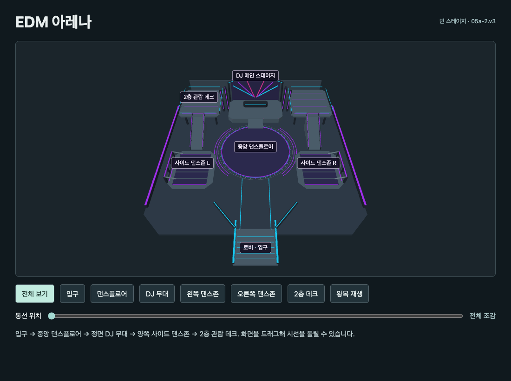
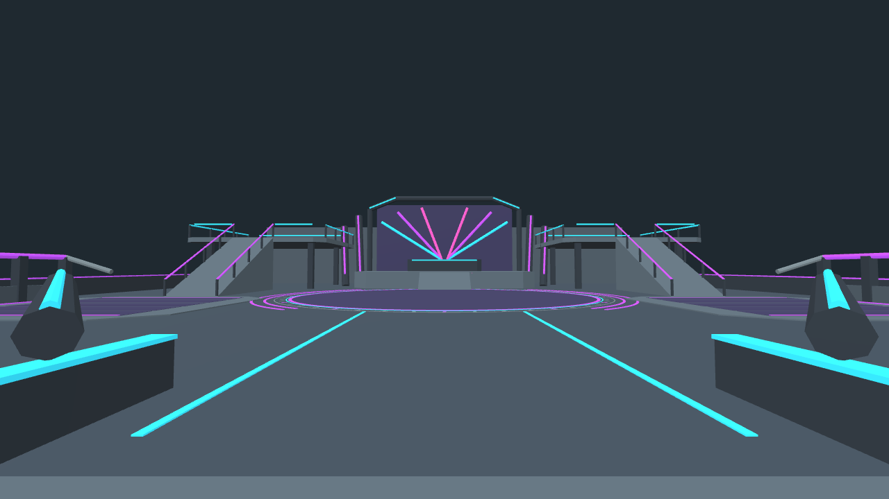

# EDM 클럽 구조 검토본

**05a-2.v3** · 입구 정면에 DJ가 서는 무대, 관객이 쓰는 중앙 원형 플로어, 양쪽 사이드 댄스존, 무대 양옆 2층 관람 데크를 배치한 빈 맵이다. 각 사이드존과 데크는 GLB에서 독립된 노드로 구분된다. 구역 개방 조건과 VIP 운영은 별도 정책 결정 사항이다.

[3D 검토 화면](stage/review.html)을 내려받아 열면 조감도에서 구역 이름을 볼 수 있다. 입구·댄스플로어·DJ 무대·왼쪽과 오른쪽 댄스존·2층 데크 버튼으로 시점을 옮기고 화면을 드래그해 시선을 돌릴 수 있다.

## 치수와 동선

단위는 m이고 Y가 높이다. 입구 (0, 0, 25)에서 중앙 플로어(지름 17m)를 지나 DJ 무대 (0, 1.35, -13)까지 간다. 플로어로 돌아와 왼쪽·오른쪽 사이드존 (±14.6, 0.045, 6)을 둘러보고 동쪽 경사로로 오른 뒤 2층 데크 (10.1, 4, -13)에서 중앙을 내려다본다. 편도 123.48m, 왕복 246.95m다.

## 데스크톱 재검수

Babylon.js 9.35.0과 PlayCanvas 2.23.3에서 동일 GLB를 불러와 Chrome 156 · 1280×720으로 측정했다. 양 엔진의 53개 메시 노드 경계와 배치 좌표가 일치했다. 검수 경로 양방향 3,030개 지점에서 바닥 누락 0건, 몸통·눈높이 경로 가로막힘 0건, 예정 경로와 표면 높이 최대 차이 약 4.10cm였다. 건축 부재가 입구 눈높이에서 부스 바로 위의 공연 기준점 (0, 2.8, -15.5) 또는 데크에서 댄스플로어 중앙으로 향하는 시선을 가로막지 않았다. 이 판정은 검수 카메라에 한정한다.

[현재 캡처와 원시 결과](stage/layout-check/) · [이전 v2 난간 검수 기록](stage/inspection/README.md)

`python3 stage/build.py`로 GLB 및 단일 파일 검토 화면을 재생성한다. 두 엔진 검수는 stage/layout-check의 index.html과 test.js 및 stage/edm-empty.glb를 임시 디렉터리에 함께 복사하고 이전 검수 기록의 동일 버전 의존성을 설치해 로컬 HTTP로 실행한다. `/?babylon`, `/?playcanvas`에서 `window.result`와 `show(0)`부터 `show(5)`까지 확인한다.

[10a-1 중앙 플로어 군무와 데스크톱 성능 비교](dance/README.md)

[G1 Google·Apple 계정 인증 실행 안내](app/README.md)

## EDM 페스티벌 인테리어 검토본

[입구](stage/festival/entry.jpg) · [발코니](stage/festival/balcony.jpg) · [바](stage/festival/bar.jpg) · [라운지](stage/festival/lounge.jpg) · [3D 모델](stage/festival/edm-festival.glb)

v3 이동 경로와 관찰점을 사용하는 무대·플로어·바·라운지 장식본이다. `python3 stage/build.py --festival`로 생성한다. 저장소 루트에서 정적 파일 서버를 열면 `/stage/festival/index.html`로 볼 수 있다. 뷰어에는 dance 패키지의 Babylon.js 의존성이 필요하다. `python3 stage/festival/pack.py edm-interior.html`로 오프라인 검토 파일을 만들 수 있다.
