# 05a-2 EDM 빈 스테이지 검수

**기하·좌표·검수 카메라 동선 통과.** 비교 대상은 05a-1.v1 커밋 `849895c`의 GLB다. 아바타·AI·음악 배치 여부는 결과 검토 후 결정한다.

## 같은 맵의 두 엔진 비교

Babylon.js 9.35.0의 glTF 로더와 PlayCanvas 2.23.3의 container 로더에서 같은 GLB를 읽었다. Babylon.js는 오른손 좌표계를 명시했다. 두 엔진이 생성한 월드 변환을 정점에 적용한 뒤 메시 경계와 삼각형을 비교했다. 재질별로 분리된 메시 조각은 원본 노드 이름으로 묶었다. 20개 노드, 10,388개 삼각형, 20개 노드의 월드 경계가 양쪽에서 일치한다.

단위는 m, 좌표 순서는 X/Y/Z, +Y는 위, +Z는 입구 방향이다. 아래는 바닥 기준 좌표이며 카메라 눈높이는 1.65m를 더한다.

| 기준점 | Babylon.js | PlayCanvas | 기준 치수 |
|---|---|---|---|
| 입구 | (0, 0, 27) | (0, 0, 27) | 입구 바닥 폭 7.30m |
| 중앙 무대 | (0, 0.80, 0) | (0, 0.80, 0) | 지름 9.80m, 높이 0.80m |
| 북측 발코니 관찰점 | (0, 4, -13) | (0, 4, -13) | 반원 외경 34.00m, 상판 높이 4.00m |

아레나 바닥 지름은 42m다. 입구·발코니의 X 또는 Y가 수치 오차 수준인 값은 반올림했다. 원시 값은 [계측 결과](results.json)에 있다.

## 왕복 동선

입구 → 정면 경사로 → 무대 중앙 → 정면 경사로 하강 → 동측 경사로 → 북측 발코니를 왕복했다. 편도 87.667m, 왕복 175.335m다. 각 엔진·화면 크기에서 27개 구간을 방향별 101점씩 샘플링해 실제 엔진 카메라를 배치했다. 5,454개 샘플에서 카메라 아래 보행 표면 누락은 0건이었다. 각 구간을 몸통(0.8m)과 눈높이(1.65m)에서 메시와 교차 검사한 결과 양방향 모두 막힘은 0건이었다.

- 무대 발판과 정면 경사로가 겹치는 접합부에서 예정 경로와 실제 바닥의 높이 차이가 최대 0.056m였다. 두 엔진이 같은 값을 재현했고 05a-1의 검수 허용치 0.07m 이내다. 이후 캐릭터 충돌 검수 시 이 접합부를 별도 확인한다.
- 발코니의 고정 관찰점에서는 안쪽 난간이 화면 전경을 차지하고 무대 일부를 가린다. 관람 시야를 어느 정도 확보할지는 배치 전 검토 사항이다.
- 실측 범위는 데스크톱 Chrome 156 / SwiftShader, 960×540 및 844×390 가로 뷰포트다. 실물 모바일·터치, 아바타 충돌 및 부하 성능은 후속 검증 대상이다. 장면 조명은 엔진별 검수 조명이므로 색상·명암은 통과 조건에서 제외했다.

## 관찰점별 비교 화면

### 960×540

| 관찰점 | Babylon.js | PlayCanvas |
|---|---|---|
| 입구 | 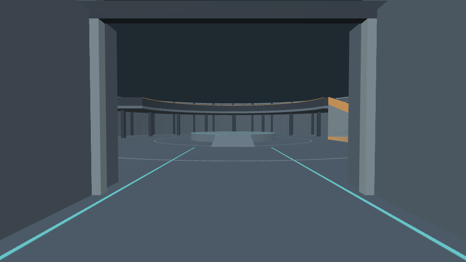 | 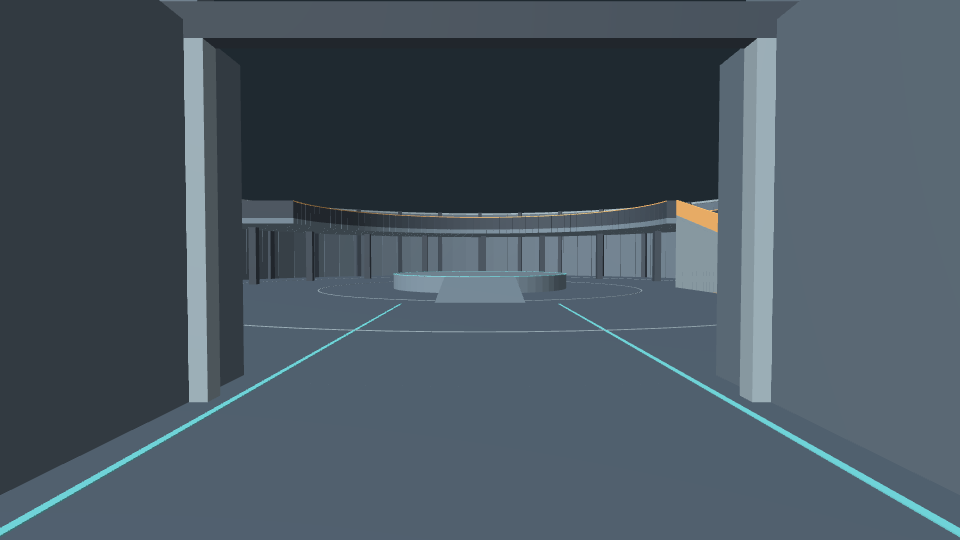 |
| 중앙 무대 | 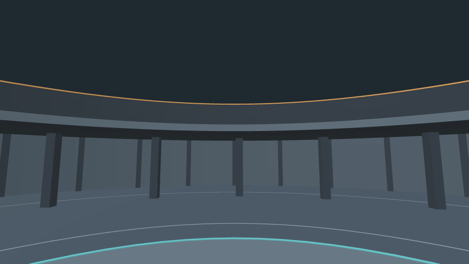 | 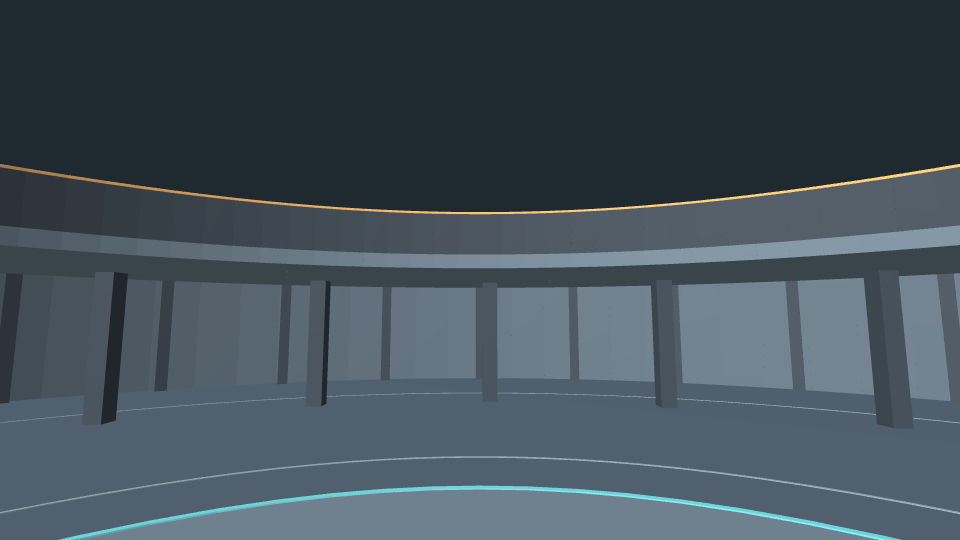 |
| 북측 발코니 | 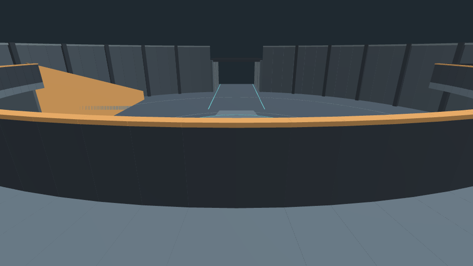 | 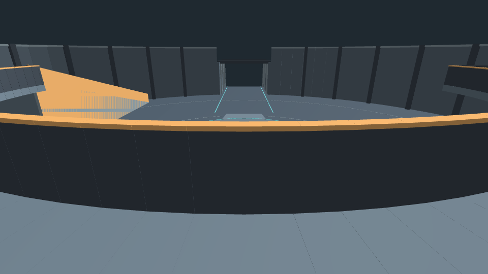 |

### 844×390

| 관찰점 | Babylon.js | PlayCanvas |
|---|---|---|
| 입구 | 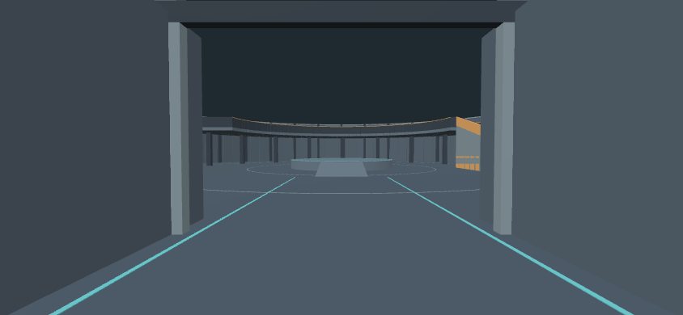 | 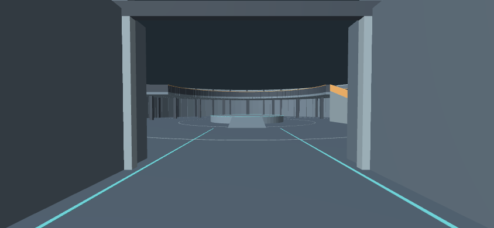 |
| 중앙 무대 | 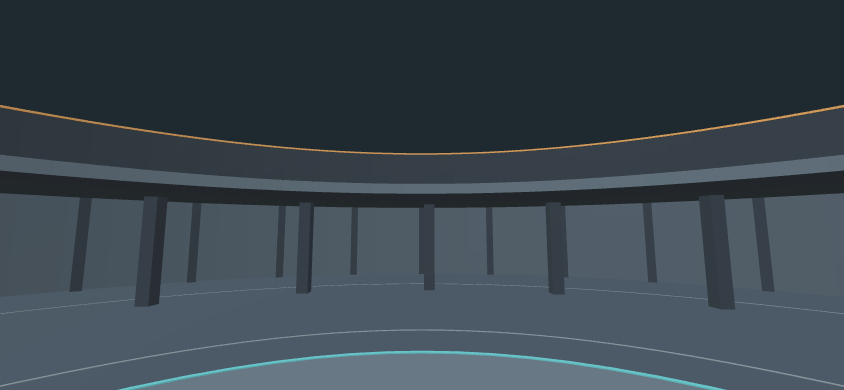 | 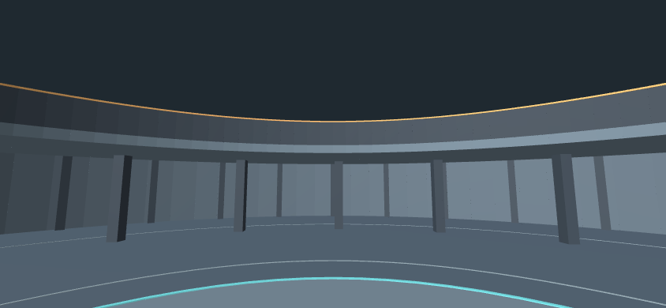 |
| 북측 발코니 | 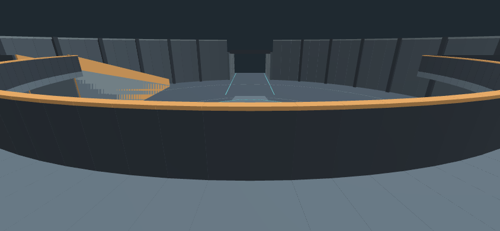 | 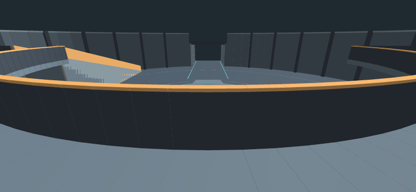 |

## 재현 방법

임시 폴더에 이 경로의 index.html, test.js와 stage/edm-empty.glb를 나란히 복사한다. 그 폴더에서 아래 순서로 실행한다.

```sh
npm install --ignore-scripts babylonjs@9.35.0 babylonjs-loaders@9.35.0 playcanvas@2.23.3
python3 -m http.server 18745 --bind 127.0.0.1
```

Chrome에서 `http://127.0.0.1:18745/?babylon` 및 `/?playcanvas`를 각각 연다. 콘솔의 `window.result`가 월드 경계·기준점·경로 측정값이며 `show(0)`, `show(1)`, `show(2)`가 입구·중앙·발코니 시점이다. 카메라 경로는 동일 파일의 extras.reviewRoute를 사용한다.
