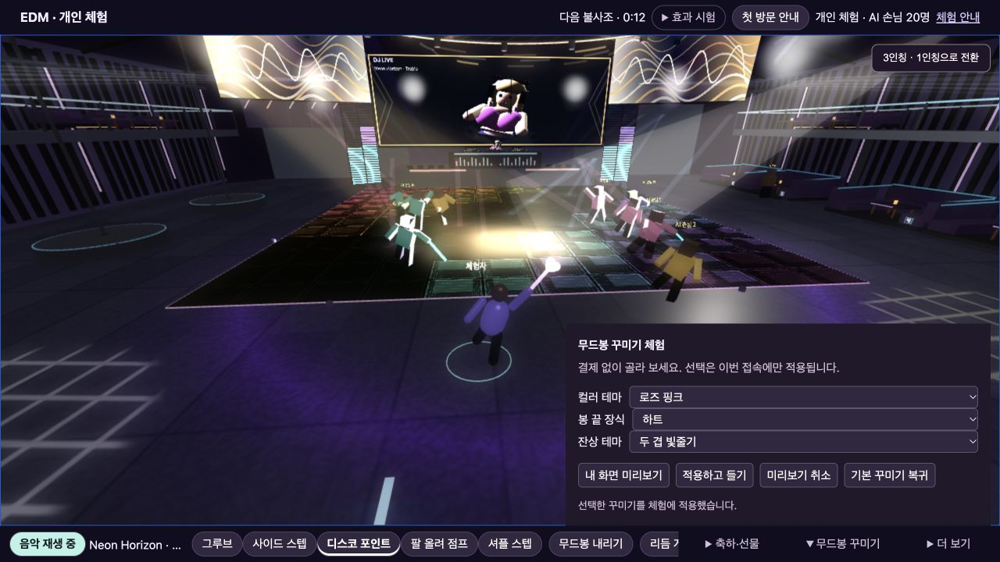
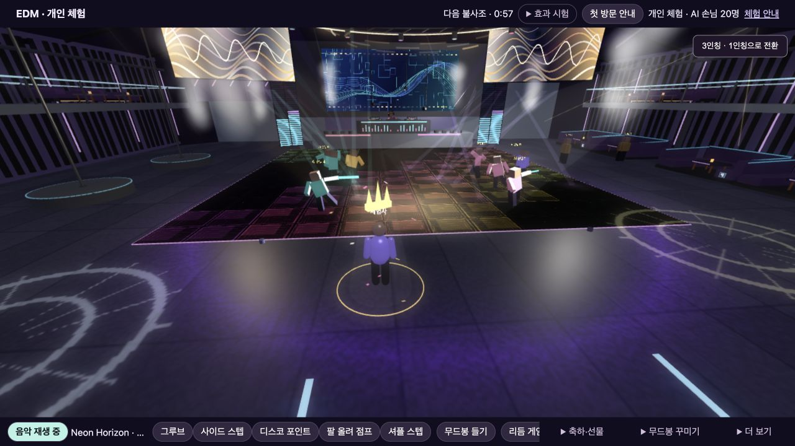
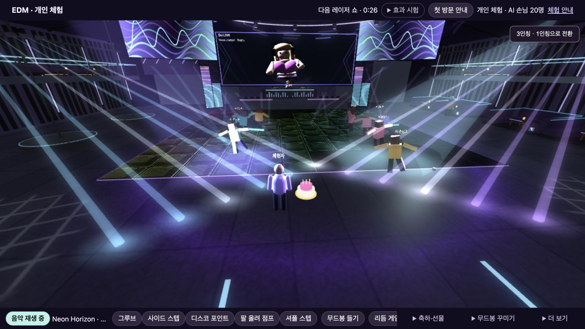

# G2 #157–#165 체험 구현·검증 기록

2026-11-13 사용자 승인: 9개 작업을 한 번에 구현하고 테스트 후 보고. 기존 연출 유지. 이전 합의의 실제 결제·미확정 판매 정책 보류는 유지한다.

## 구현 범위

- #157: 캐릭터 클릭/목록 선택, 생일 제안·수락·거절·취소·퇴장, 수신자로 체험하는 경로. 생일은 실제 수신자 또는 명시적인 체험 응답 뒤에만 실행한다.
- #158: 컬러·끝 장식·잔상 구성의 선택/미리보기/취소/적용/기본 복귀. 세션 내부 상태와 기존 비운영 Colyseus 시험 회원의 적용 상태 전파.
- #159: 기존 수락 후 LED에 추가하여 대상 전용 국소 조명·왕관·바닥 고리·마지막 국소 종이조각을 독립 모듈로 표시. 이동/착석 대상의 실제 렌더 위치를 따른다.
- #160: 하트가 발신자에서 대상으로 이동 후 퍼지는 내 화면 미리보기.
- #161: 기존 춤과 오른손 무드봉을 유지한 왼손 꽃다발 받기 표현. 기존 관절/춤 동작을 덮어쓰지 않고 꽃다발 자체가 짧게 기울고 흔들린다.
- #162: 촛불 케이크 미리보기. 서 있을 때는 캐릭터 앞 옆쪽, 착석한 경우 기존 1층/2층 테이블 상판 좌표 사용. 충돌·점유·예약은 만들지 않는다.
- #163: 기본 하늘색/라벤더/로즈 핑크/웜 골드 체험용 팔레트.
- #164: 없음/별/하트/왕관의 봉 끝 장식.
- #165: 기존 기본 궤적/두 겹 빛줄기/별가루 궤적. 기존 실제 손끝의 시간 보간 경로를 재사용한다.

새 효과는 `app/public/social-effects.js`와 `app/social-trial.js`에 격리한다. 기존 음악·공연 일정·레이저·싸이키·플로어·NPC·맵과 다섯 춤은 변경하지 않는다. 이미 승인된 생일 LED 미리보기 경로는 유지한다. 새 효과 종료 버튼은 새 효과와 해당 생일 LED만 종료하며 다른 시험 공연은 중단하지 않는다.

## 자동 검증

실행: `node --test validation/social-items-trial.test.mjs`

10 tests / 10 passed / 0 failed.

1. 수신자 권한·거절·취소·퇴장·중복 응답과 무단 수락 방지.
2. 새 효과의 수명·중단·대상 퇴장 시 제거.
3. 컬러 4 × 장식 4 × 잔상 3 = 48개 구성과 잘못된 스타일/권한 필드 거절.
4. 장식별 생성·부착·제거와 유한 정점 데이터.
5. 잔상별 곡선 경로·리셋·자원 해제.
6. 이동/착석 생일 대상 추적, 마지막 종이조각, 대상 전용 조명 제거, 기존 조명 값 불변.
7. 세 선물의 생성·종료·중단과 기존 춤 관절 값 불변.
8. 1층/2층 케이크 상판 좌표와 서 있는 대상 배치.
9. 실제 EdmRoom 메시지 핸들러의 3개 시험 세션: 장착 상태·잘못된 입력 거절·수신자만 수락·중복 실행 방지·중단·퇴장. WebSocket 연결 부하 시험은 아니다.
10. 기준 커밋 `dc38655` 대비 기존 음악/GLB/다섯 춤/바닥/천장/공연 일정/기존 효과 파일 변경 없음.

## 실제 데스크톱 화면 확인

내보낸 실제 체험판을 임시 로컬 HTTP 서버와 IAB 1280×720에서 확인했다. 시험 종료 후 브라우저와 음악, 임시 서버를 모두 종료했다.

- Neon Horizon과 기존 클럽 장면 정상 재생.
- 별+두 겹 잔상, 왕관+별가루, 하트 장식 미리보기, 적용, 취소 및 기본 복귀 확인.
- 캐릭터 클릭으로 AI 손님 4 선택, 목록으로 AI 손님 5 선택, 제안 대기·취소 확인.
- 수신자 체험에서 거절하면 연출되지 않음. 다시 수락하면 LED·왕관·고리·국소 조명이 표시되고 종료 후 기존 공연으로 복귀.
- 하트 전달, 꽃다발과 오른손 무드봉 동시 표시, 케이크와 촛불 표시, 새 효과 종료 확인.
- UI에서 발견한 이전 취소 상태 잔존, 케이크 가림, 하트/왕관 방향 및 새 물체의 과한 번짐을 수정하고 해당 항목만 재확인.
- 브라우저 오류 로그 0건. 장시간/부하/모바일 검증은 하지 않았다.

## 검증 범위와 보류

공개 Sites는 각각 독립된 개인 체험이다. 화면에서 보이는 체험 손님의 수락/거절은 직접 조작하는 시뮬레이션이다. 작은 선물은 실제 전송/소모/결제 없이 내 화면에서만 미리 본다. 실제 사용자에게 보내는 작은 선물의 동의·횟수·만료/가격/소유 정책은 정하지 않는다.

생일 15초, 하트 4초, 꽃다발 8초, 케이크 10초 및 각 꾸미기 선택지는 체험용 표시 구성이지 판매 정책 확정이 아니다. 실제 결제, 상품 보유·지급, 영구 저장, 서비스 로그인·음원 증빙, 모바일, 실제 WebSocket 다중 참가자 검증은 보류다. 유료 거래·환불·큐는 기존 G2 Issue를 유지한다.

기존 Epic #8 / 실제 Milestone G2 (#3)와 기존 Issue 번호·선행 관계를 유지한다. 이 기록은 체험 범위의 구현/검증 완료이며 실제 판매 출시 완료를 뜻하지 않는다. main 병합은 별도 승인 후 진행한다.
